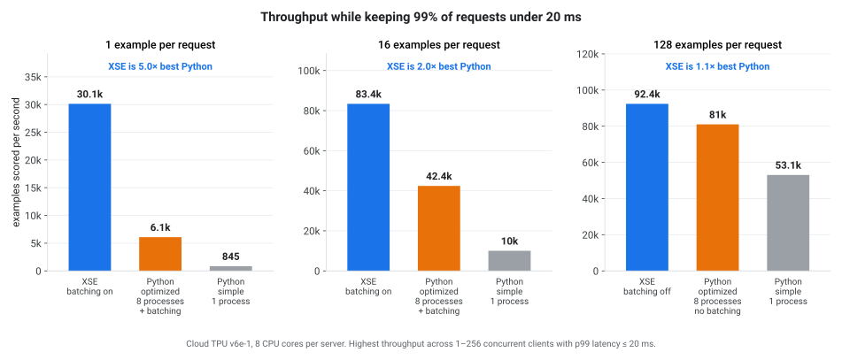
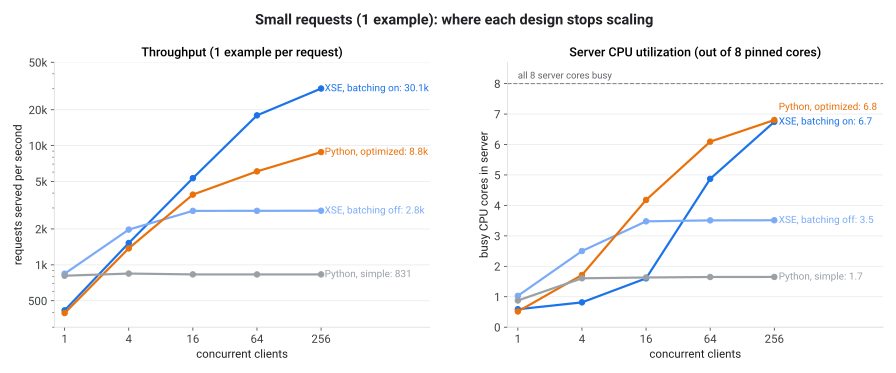
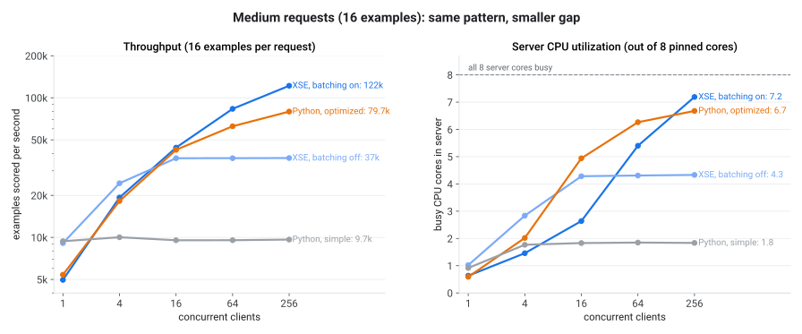
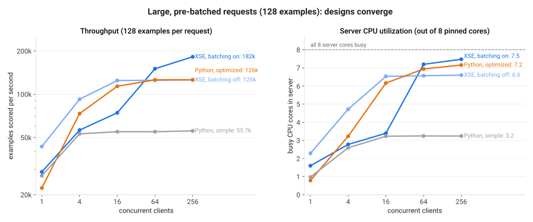
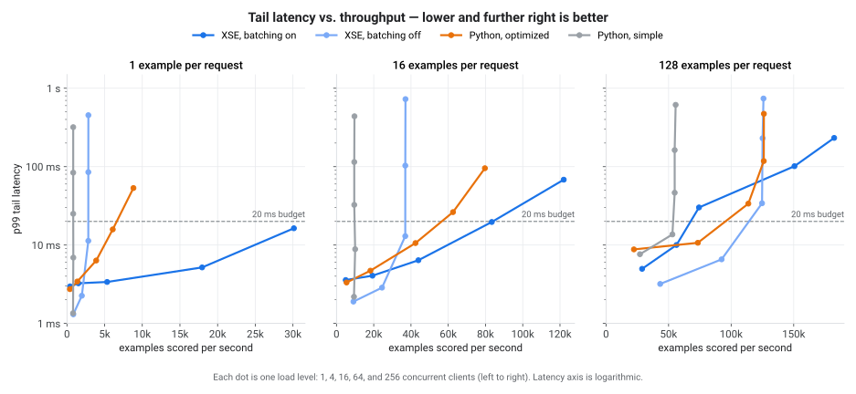
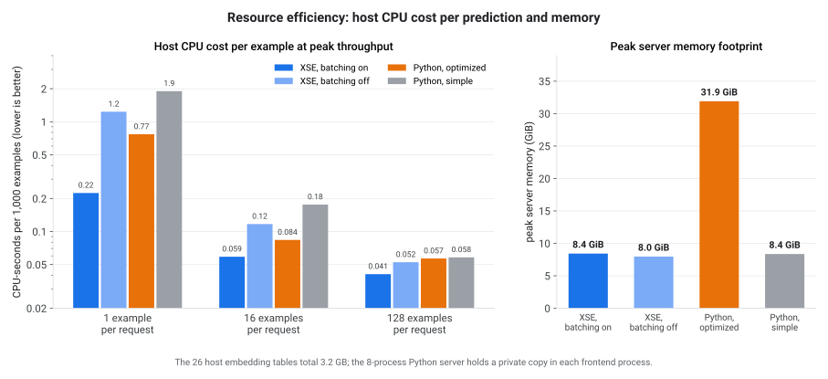

# DLRM serving: XLA Serving Engine vs. Python

When deploying a JAX model to production, the natural baseline is a Python
service wrapping `jax.jit` with NumPy input preprocessing and `grpc.server`.
This benchmark measures how that baseline—both in its simplest single-process
form and in an optimized multi-process, dynamically batched design—compares
against **XLA Serving Engine (XSE)** on the same model, weights, wire protocol,
and hardware. All benchmark code—model export, the XSE and Python servers, the
load generator, and the runner script—is available to inspect in
[`examples/dlrm_benchmark/`](https://github.com/openxla/xla-serving/tree/main/examples/dlrm_benchmark).

## Summary

We served the same **DLRM-DCNv2** recommendation model on a single **Cloud TPU
v6e-1** VM (`ct6e-standard-1t`), pinning every server under test to the same
8 host CPU cores and driving load from a separate 16 CPU cores on the machine.

| Items / request | XSE (examples/s) | Best Python (examples/s) | XSE vs. best Python | Single-process Python |
|---|---|---|---|---|
| **1** | **30,100** | 6,100 | **5.0×** | 845 (36×) |
| **16** | **83,400** | 42,400 | **2.0×** | 10,000 (8.3×) |
| **128** | **92,400** | 81,000 | **1.14×** | 53,100 (1.7×) |

*Throughput in examples (predictions) per second while keeping 99% of requests
under 20 ms (`p99 ≤ 20 ms`). All numbers are medians of three 30-second runs
with zero errors.*

- **Small and medium requests (online serving):** XSE delivers **2–5×** the
  throughput of the strongest multi-process Python server—and **8–36×** that of
  a standard single-process Python server—within a 20 ms tail-latency budget.
- **Lower host resource cost:** At peak throughput, XSE uses **30–70% less host
  CPU time per prediction** and **~4× less RAM** than the 8-process Python
  server (8.0–8.4 GiB vs. 31.9 GiB), because one C++ process saturates all
  cores without replicating the 3.2 GB embedding tables across worker processes.
- **Large pre-batched requests:** When callers already send 128 items per
  request, per-request Python and launch overheads amortize out; a multi-process
  Python server reaches **88%** of XSE's throughput under a 20 ms budget
  (**1.14×** gap, widening to **1.45×** with no latency ceiling), leaving the
  ~1.4× per-core speedup of XSE's C++ embedding kernel as the remaining
  difference.



---

## What we measured

### Workload: DLRM-DCNv2 with host CPU embeddings

Recommendation and ranking models combine memory-bound sparse table lookups with
compute-bound dense interaction networks. The benchmark uses the Criteo-scale
**DLRM-DCNv2** architecture from
[`examples/dlrm`](https://github.com/openxla/xla-serving/tree/main/examples/dlrm):

1. **Host CPU embedding lookups.** 26 categorical embedding tables (`6.2M` rows
   total at `embedding_size = 128`, **3.2 GB** of `float32` weights) reside in
   host RAM. Every item scored performs **214 scattered row reads** across the
   26 tables (~110 KB of random memory traffic per item) and sum-pools each
   table into a `(128,)` vector.
2. **Accelerator DCNv2 network.** The 26 pooled vectors plus 13 `float32` dense
   features transfer to the TPU, which runs bottom MLPs, three low-rank cross
   layers (`projection_dim = 512`), and top MLPs to emit one score per item.

In XSE, the CPU lookups execute in-process through `xla_serving_data`'s C++
`CompositeProcessor` (JAX CPU Embedding / JCE), with no TensorFlow dependency.
In the Python servers, the lookups use vectorized `np.take` + `sum` into a
pre-allocated `(B, 26, 128)` buffer.

### Terminology and methodology

- **Example:** One candidate item scored by the model. Throughput is reported in
  *examples per second* (`requests/s × request_batch_size`).
- **Request size (`B_req`):** Examples carried by each `PredictRequest` (`1`,
  `16`, or `128`). Small requests represent per-item or small-slate online
  calls; large requests represent pre-batched scoring.
- **Concurrent clients (`C`):** Closed-loop callers (`1`, `4`, `16`, `64`, and
  `256`) issuing back-to-back requests over 64 persistent gRPC connections
  (8 worker processes × 8 connections). We also run open-loop Poisson arrivals
  at 50% and 80% of each setup's measured closed-loop peak.
- **Latency (`p50` / `p99`):** Client-observed end-to-end RPC latency in
  milliseconds. Our primary comparison reports the highest throughput achieved
  while `p99 ≤ 20 ms`.
- **Dynamic request batching:** Batched setups wait up to `1 ms`
  (`batch_timeout_micros = 1000`) to coalesce concurrent requests up to `4,096`
  examples, padding up to power-of-two batch buckets (`1, 2, 4, …, 4096`) so
  padding overhead never exceeds 2×.

### Fairness invariants

Every non-runtime variable is held constant across all setups:

- **Hardware and CPU pinning:** Single `ct6e-standard-1t` VM (44-vCPU AMD EPYC,
  173 GiB RAM, 1× Cloud TPU `v6e` chip). Every server is pinned to CPUs `0-7`
  (`--cpuset-cpus` / `taskset -c`), and the load generator and resource monitor
  are pinned to CPUs `8-23`.
- **Identical weights and numerical parity:** `export_benchmark_model.py`
  generates seeded weights once and writes both XSE bundles and the NumPy weight
  archives. Before load starts, `parity_check.py` verifies every server matches
  an independent reference within `max|Δ| ≤ 6.3 × 10⁻⁶` (at `atol = 1e-4`).
- **Identical wire format and compiler stack:** All arms serve the exact same
  `PredictionService/Predict` protobuf RPC (`HostBufferProto` tensors) on JAX
  `0.11.2`, `libtpu` `0.0.48`, and Python `3.12`.
- **Measurement window:** 5 seconds of discarded warm-up followed by 30 seconds
  of measured traffic per point, repeated 3 times (378 runs total across 6
  setups; 0 failed RPCs). Reported figures are the median across the 3 repeats.

### Server setups compared

Six server configurations are run by the benchmark suite. Four anchor the main
comparison (the remaining two single-knob ablations are included in
[Reference data](#reference-data)):

| Label in charts | Harness arm | Architecture |
|---|---|---|
| **XSE, batching on** | `xse-batch` | C++ gRPC server (`tpu-jax-only`) with `PRE_PROCESSOR_AND_MODEL_FUNCTION` dynamic batching (batches CPU embedding lookups and TPU execution together). |
| **XSE, batching off** | `xse-nobatch` | Same C++ server with `NO_BATCHING` (one lookup + TPU call per request; lowest light-load latency). |
| **Python, optimized** | `py-mp-batch` | 8 `SO_REUSEPORT` frontend processes (each with its own GIL, table copy, and `DynamicBatcher` in front of its NumPy gather) feeding 1 TPU-owner process via `/dev/shm` rings and a zero-wait batch merger. |
| **Python, simple** | `py` | Single Python process: `grpc.server` (8 worker threads) + NumPy gather + `jax.jit`. |

---

## Results

### Small requests (1 example per request)

Single-item requests stress per-RPC handling, thread scheduling, and batch
formation because fixed per-request work cannot be amortized by the caller.



- **Python, simple (`py`)** flat-lines at **~845 requests/s** from 4 clients
  onward while using only **1.7 of its 8 CPU cores**—threads serialize on the
  Python GIL during protobuf parsing and NumPy array handling.
- **XSE, batching off (`xse-nobatch`)** plateaus at **2,845 requests/s** using
  3.5 cores, bounded by the fixed per-call TPU dispatch rate rather than host
  CPU.
- **Python, optimized (`py-mp-batch`)** scales across 6.8 cores to **8,825
  requests/s** at 256 clients, but its `p99` latency climbs to `53 ms`. Within
  the `p99 ≤ 20 ms` budget it reaches **6,081 requests/s** (at `C = 64`).
- **XSE, batching on (`xse-batch`)** reaches **30,126 requests/s** at `C = 256`
  with `p99 = 16.4 ms` (**5.0×** the best Python setup under 20 ms, and **36×**
  single-process Python). At 6.75 of 8 cores busy, its curve is still rising.

### Medium requests (16 examples per request)

With 16 items per request, each RPC carries 16× more useful scoring work per
network round trip, narrowing—but not closing—the runtime overhead gap.



- Unbatched servers remain capped by accelerator call rate (`37,000 examples/s`
  for `xse-nobatch`, `10,000 examples/s` for `py`).
- With dynamic batching, **`xse-batch`** climbs to **122,000 examples/s** at
  `C = 256` (`p99 = 68.2 ms`), vs. **79,700 examples/s** (`p99 = 95.4 ms`) for
  **`py-mp-batch`**.
- Under `p99 ≤ 20 ms`, **`xse-batch` delivers 83,400 examples/s vs. 42,400 for
  `py-mp-batch` (2.0×)** and `10,000` for `py` (**8.3×**).

### Large, pre-batched requests (128 examples per request)

When callers already batch 128 items into every request, server-side batching
becomes unnecessary at low-to-moderate concurrency and all multi-core designs
become host-CPU-lookup-bound.



- **Batching off wins at moderate concurrency (`C ≤ 16`).** Waiting `1 ms` to
  coalesce already-large 128-item requests adds latency, and batching
  `PRE_PROCESSOR_AND_MODEL_FUNCTION` funnels merged requests into larger
  single-slot lookups. Up to 16 clients, `xse-nobatch` leads
  (`92,400 examples/s` at `p99 = 6.6 ms` for `C = 4`, and `124,700 examples/s`
  at `p99 = 34.1 ms` for `C = 16`). At `C ≥ 64`, `xse-batch` pulls ahead to
  **182,300 examples/s** (`1.45×` the best Python peak of `126,200`).
- **Under `p99 ≤ 20 ms`**, **`xse-nobatch` serves 92,400 examples/s vs. 81,000**
  for 8-process Python without batching (`py-mp`, **1.14×**) and `53,100` for
  single-process Python (**1.7×**).

### Tail latency vs. throughput

Plotting `p99` latency against achieved throughput shows the operating envelope
of each design across all three request sizes (lower and further right is
better; vertical segments indicate saturation):



At `1` and `16` examples per request, `xse-batch` achieves lower tail latency at
every throughput reachable by any Python server—for example, at ~43,000
examples/s with 16-item requests, `xse-batch` answers at `p99 = 6.4 ms` vs.
`10.6 ms` for `py-mp-batch`.

### Host CPU and memory efficiency



- **Host CPU cost:** At peak throughput, `xse-batch` spends **0.224, 0.059, and
  0.041 CPU-seconds per 1,000 examples** at request sizes `1`, `16`, and `128`,
  compared to `0.770`, `0.084`, and `0.057` for `py-mp-batch` (**3.4×, 1.4×, and
  1.4× more CPU** in Python).
- **Memory footprint:** `xse-batch` (`8.4 GiB`), `xse-nobatch` (`8.0 GiB`), and
  single-process `py` (`8.4 GiB`) each hold a single copy of the 3.2 GB
  embedding tables. Because `fork()` is unsafe once gRPC and JAX initialize
  threads, `py-mp-batch` spawns 8 independent frontend processes, each loading a
  private anonymous-memory copy of the tables for **31.9 GiB** total (**~4×**
  XSE's footprint). That gives every worker transparent huge pages (`2 MiB` TLB
  entries) for maximum gather speed; a custom Python deployment could avoid the
  `4×` RAM duplication via pre-import `fork()` copy-on-write or hugepage-backed
  `/dev/shm` (`tmpfs`) mappings.

### Tail predictability under steady open-loop load

Under open-loop Poisson arrivals at **80% of each setup's own peak rate**, every
server completed with zero errors, but tail stability differed sharply:

- **`xse-batch` `p99` across the 3 repeats** stayed within ~5%:
  `9.6 / 9.5 / 9.5 ms` at `B_req = 1` (`24,142 req/s`), and
  `29.4 / 29.7 / 29.9 ms` at `B_req = 16` (`6,113 req/s`).
- **`py-mp-batch` `p99` across identical repeats** swung by up to 5× due to GIL
  and GC pauses transiently backing up frontend batch queues:
  `583 / 112 / 106 ms` at `B_req = 1` (`7,097 req/s`) and `138 / 48 / 95 ms` at
  `B_req = 16` (`3,998 req/s`).

---

## Why XSE is faster — and when Python is enough

Three concrete bottlenecks govern hybrid CPU-embedding + accelerator serving:

1. **The Python GIL caps one process at ~1.6–1.8 cores.** Protobuf
   deserialization, feature validation, and NumPy dispatch contend on the
   interpreter lock, leaving >6 of 8 cores idle in `py`. Multi-process Python
   (`py-mp*`) works around the GIL via `SO_REUSEPORT` frontends + `/dev/shm`
   rings + a single device-owner process (since only one process can open a TPU
   chip), at the cost of `4×` RAM and IPC complexity. XSE's C++ server scales
   across all cores in a single process.
2. **Per-call device dispatch caps unbatched servers at ~2,000–2,800 calls/s.**
   Transferring 27 input tensors, launching the XLA program, and reading outputs
   back imposes a fixed overhead independent of batch size between 1 and 16
   examples. XSE's built-in C++ `SharedBatchScheduler` coalesces requests
   without parking Python threads.
3. **C++ `CompositeProcessor` lookups outperform NumPy gathers by ~1.4× per
   core.** Once GIL contention and launch overhead are removed, throughput is
   bounded by the 214 scattered DRAM reads per example. XSE's C++ embedding
   kernel sustains **24,500 examples/core-s** at `B_req = 128` (and `17,000` at
   `B_req = 16`) vs. `17,600` (`11,900`) for NumPy `take` + `sum`.

### Where Python is competitive

- **Single-client light-load latency:** At `C = 1`, single-process `py` answers
  in `1.23 ms` (`B_req = 1`) and `1.69 ms` (`B_req = 16`), matching
  `xse-nobatch` (`1.18 ms` and `1.75 ms`).
- **Pre-batched traffic against untuned server batching:** At `B_req = 128` and
  `C = 16`, `py-mp-batch` (`113,700 examples/s`) exceeds `xse-batch` (`74,300`)
  and trails only `xse-nobatch` (`124,700`). When callers already send large
  batches, disable server-side batching (`NO_BATCHING`) or batch only
  `MODEL_FUNCTION` rather than re-batching the preprocessor.

### Scope and caveats

- **Python runtime version:** All Python setups ran on standard GIL-enabled
  CPython `3.12`. Newer CPython releases (`3.13` / `3.14`)—in particular
  experimental free-threaded (no-GIL, PEP 703) builds and the experimental
  JIT—were not evaluated here. Once the surrounding extension stack (`grpcio`,
  `protobuf`, `numpy`, `jaxlib`) runs without falling back to the GIL, a
  free-threaded build could let a single Python process scale across cores
  without multi-process IPC or `4×` table memory duplication—though
  `py-mp-batch` already gives each worker core an independent interpreter and
  GIL, isolating the remaining CPython/gRPC-Python per-RPC and NumPy lookup
  costs.
- **Pure-Python + NumPy baseline scope:** The Python arms intentionally stay
  within standard Python building blocks (`grpcio`, NumPy, and `jax.jit`) rather
  than custom C++/Cython/Numba extensions or framework-specific C++ operators
  such as PyTorch `EmbeddingBag`. A custom native gather kernel would narrow the
  ~1.4× per-core lookup gap at large batch sizes while leaving Python gRPC
  handling, GIL/multi-process coordination, and dynamic batching unchanged; the
  comparison here isolates what XSE provides out of the box without writing
  model-specific native serving code.
- Measurements above come from a single hardware slice (1× TPU `v6e` chip, 8 of
  44 host vCPUs allocated to the server, loopback gRPC on the same VM). Adding
  server CPU cores raises lookup-bound ceilings for both XSE and `py-mp*` while
  preserving per-core efficiency ratios.
- Sparse IDs are drawn uniformly at random (`rng.integers(0, vocab)`), stressing
  worst-case LLC/DRAM locality; Zipf-skewed production traffic increases CPU
  cache hit rates for all setups.
- At `B_req = 1` and `C = 256`, `xse-batch` used `6.75 / 8` cores (`84%`) with
  `p99 = 16.4 ms`, so `30,100 examples/s` is a lower bound on its `p99 ≤ 20 ms`
  capacity.

---

## Reproducing the benchmark

The complete benchmark suite lives in
[`examples/dlrm_benchmark/`](https://github.com/openxla/xla-serving/tree/main/examples/dlrm_benchmark)
in the repository and requires no local C++ Bazel build when using prebuilt
wheels and server container images.

### 1. Provision a machine and install packages

::::{tab-set}
:::{tab-item} Cloud TPU
Create a single-chip TPU v6e (or v5e) VM:

```bash
gcloud compute tpus tpu-vm create xse-bench-tpu \
  --zone=us-central1-b \
  --accelerator-type=v6e-1 \
  --version=v2-alpha-tpuv6e
```

On the VM, create a Python 3.12 virtual environment and install the packages
from PyPI plus `jax[tpu]` (requires Python 3.12+; install `python3.12` or use
`uv` if the base VM image ships Python 3.10):

```bash
git clone https://github.com/openxla/xla-serving
cd xla-serving

python3.12 -m venv .venv
source .venv/bin/activate

pip install xla-saved-model xla-serving-data
pip install -r examples/dlrm_benchmark/requirements.txt
pip install "jax[tpu]" \
  -f https://storage.googleapis.com/jax-releases/libtpu_releases.html

python3 -c "import jax; print(jax.devices())"
```
:::

:::{tab-item} NVIDIA GPU
Create an A100 (or L4 / H100) Deep Learning VM with Docker and NVIDIA Container
Toolkit preinstalled:

```bash
gcloud compute instances create xse-bench-gpu \
  --zone=us-central1-a \
  --machine-type=a2-highgpu-1g \
  --accelerator=type=nvidia-tesla-a100,count=1 \
  --image-family=common-cu129-ubuntu-2204-nvidia-580 \
  --image-project=deeplearning-platform-release \
  --boot-disk-size=200GB \
  --maintenance-policy=TERMINATE
```

On the VM, set up Python 3.12, the XSE packages, and `jax[cuda12]`:

```bash
git clone https://github.com/openxla/xla-serving
cd xla-serving

python3.12 -m venv .venv
source .venv/bin/activate

pip install xla-saved-model xla-serving-data
pip install -r examples/dlrm_benchmark/requirements.txt
pip install "jax[cuda12]"

python3 -c "import jax; print(jax.devices())"
```
:::

:::{tab-item} CPU (smoke test)
On any Linux `x86_64` workstation with Docker, verify the full pipeline with
capped vocabulary tables in ~5 minutes:

```bash
git clone https://github.com/openxla/xla-serving
cd xla-serving

python3.12 -m venv .venv
source .venv/bin/activate

pip install xla-saved-model xla-serving-data
pip install -r examples/dlrm_benchmark/requirements.txt
pip install jax
```
:::
::::

### 2. Run the benchmark suite

Configure Docker authentication for Artifact Registry
(`gcloud auth configure-docker us-docker.pkg.dev --quiet`) and invoke
`run_benchmark.sh` with a prebuilt server image tag (`nightly` or `latest`):

::::{tab-set}
:::{tab-item} Cloud TPU (v6e-1)
Reproduces the exact 8-server-core / 16-client-core configuration reported on
this page:

```bash
examples/dlrm_benchmark/run_benchmark.sh \
  --platform tpu \
  --xse_image us-docker.pkg.dev/xla-serving-engine/xla-serving/tpu-jax-only:nightly \
  --server_cpus 0-7 \
  --client_cpus 8-23 \
  --num_threads 8 \
  --num_processes 8 \
  --work_dir /tmp/dlrm_benchmark
```

*Note:* On a smaller `v5litepod-1` VM (24 vCPUs, 48 GB RAM), pass
`--num_processes 4` (or lower `--num_threads`) so `N × 3.2 GB` of Python table
copies fit comfortably in host RAM. On a Compute Engine VM created without the
Cloud TPU API, `run_benchmark.sh` automatically derives and forwards the
single-host `TPU_*` topology variables.
:::

:::{tab-item} NVIDIA GPU (A100)
```bash
examples/dlrm_benchmark/run_benchmark.sh \
  --platform cuda \
  --xse_image us-docker.pkg.dev/xla-serving-engine/xla-serving/gpu-jax-cuda12:nightly \
  --server_cpus 0-7 \
  --client_cpus 8-11 \
  --num_threads 8 \
  --work_dir /tmp/dlrm_benchmark
```
:::

:::{tab-item} CPU (smoke test)
```bash
examples/dlrm_benchmark/run_benchmark.sh \
  --platform cpu \
  --xse_image us-docker.pkg.dev/xla-serving-engine/xla-serving/cpu-jax-only:nightly \
  --max_vocab_size 1000 \
  --duration 5 \
  --warmup 1 \
  --repeats 1 \
  --concurrencies 1,8 \
  --request_batch_sizes 1,16 \
  --num_threads 2 \
  --num_processes 2
```
:::
::::

Pass `--dry_run` to print every export, `docker run`, parity-check, loadgen, and
report command without starting any process, or `--arms xse-batch,py-mp-batch`
to run a subset of setups.

### 3. Inspect outputs

When the sweep finishes, `<work_dir>/results/` contains:

- **`REPORT.md`** — Markdown report starting with **Throughput under
  `p99 ≤ 20 ms` latency budget** and **Peak throughput (no latency limit)**—each
  with an `XSE vs best Python` speedup column—followed by the full closed-loop
  concurrency sweep, open-loop Poisson latency table, and run metadata.
- **`env.txt`** — Exact timestamp, CPU model, RAM, JAX/`libtpu` versions, TPU
  topology variables, and container image digest (`RepoDigests`).
- **`<arm>/*.json` & `*.monitor.json`** — Raw per-point load-generator latency
  summaries, gRPC error-code histograms, and host CPU / RSS / PSS / GPU samples.

See
[`examples/dlrm_benchmark/README.md`](https://github.com/openxla/xla-serving/blob/main/examples/dlrm_benchmark/README.md)
in the repository for individual CLI flags, custom batch-bucket sweeps, and
troubleshooting notes.

---

## Reference data

:::{dropdown} Full measurement tables (all 6 setups, TPU v6e-1, 8 server cores)

### All six setups

| Setup (`arm`) | Description |
|---|---|
| `xse-batch` | C++ XSE server (`tpu-jax-only`), `PRE_PROCESSOR_AND_MODEL_FUNCTION` dynamic batching |
| `xse-nobatch` | C++ XSE server (`tpu-jax-only`), `NO_BATCHING` |
| `py-mp-batch` | 8 `SO_REUSEPORT` Python frontends with per-frontend `DynamicBatcher` + 1 TPU owner with zero-wait merger |
| `py-mp` | 8 `SO_REUSEPORT` Python frontends + 1 TPU owner, no batching |
| `py-batch` | Single Python process with `DynamicBatcher` in front of NumPy lookups |
| `py` | Single Python process (`grpc.server` + NumPy + `jax.jit`), no batching |

### Throughput across tail-latency budgets (examples/s; best XSE / best Python)

| `B_req` | `p99 ≤ 10 ms` | `p99 ≤ 20 ms` | `p99 ≤ 50 ms` | Unbounded peak |
|---|---|---|---|---|
| **1** | 17,941 / 3,884 → **4.6×** | 30,126 / 6,081 → **5.0×** | 30,126 / 6,081 → **5.0×** | 30,126 / 8,825 → **3.4×** |
| **16** | 43,975 / 23,662 (`py-mp`) → **1.9×** | 83,375 / 42,407 → **2.0×** | 83,375 / 62,554 → **1.3×** | 122,011 / 79,682 → **1.5×** |
| **128** | 92,373 (`xse-nobatch`) / 81,011 (`py-mp`) → **1.14×** | 92,373 (`xse-nobatch`) / 81,011 (`py-mp`) → **1.14×** | 124,693 (`xse-nobatch`) / 115,477 (`py-mp`) → **1.08×** | 182,323 / 126,174 → **1.45×** |

### Unbounded peak throughput per setup (examples/s)

| `B_req` | `xse-batch` | `xse-nobatch` | `py-mp-batch` | `py-mp` | `py-batch` | `py` |
|---|---|---|---|---|---|---|
| **1** | **30,126** | 2,845 | 8,825 | 2,084 | 1,326 | 845 |
| **16** | **122,011** | 37,043 | 79,682 | 31,205 | 16,401 | 10,029 |
| **128** | **182,323** | 125,841 | 126,174 | 118,020 | 87,633 | 55,650 |

### Single-client latency at `C = 1` (`p50 / p99` ms)

| `B_req` | `xse-batch` | `xse-nobatch` | `py-mp-batch` | `py` |
|---|---|---|---|---|
| **1** | 2.36 / 2.97 | **1.18 / 1.31** | 2.53 / 2.73 | 1.23 / 1.35 |
| **16** | 3.22 / 3.58 | 1.75 / **1.90** | 2.95 / 3.33 | **1.69** / 2.19 |
| **128** | 4.38 / 4.97 | **2.94 / 3.19** | 5.71 / 8.80 | 4.65 / 7.64 |

### Server CPU-seconds per 1,000 examples and peak memory

| `B_req` | `xse-batch` | `xse-nobatch` | `py-mp-batch` | `py-mp` | `py-batch` | `py` |
|---|---|---|---|---|---|---|
| **1** | **0.224** | 1.235 | 0.770 | 1.663 | 0.818 | 1.902 |
| **16** | **0.059** | 0.117 | 0.084 | 0.140 | 0.114 | 0.176 |
| **128** | **0.041** | 0.052 | 0.057 | 0.056 | 0.054 | 0.058 |
| **Peak memory (`B_req = 128`)** | **8.4 GiB** | **8.0 GiB** | 31.9 GiB | 32.6 GiB | 9.6 GiB | 8.4 GiB |

### Open-loop Poisson traffic at 80% of each setup's own peak

Achieved requests/s and median `p99` latency across 3 repeats (per-repeat `p99`
in parentheses where informative; 0 errors in every cell):

| `B_req` | `xse-batch` | `xse-nobatch` | `py-mp-batch` | `py-mp` | `py` |
|---|---|---|---|---|---|
| **1** | 24,142/s, **9.5 ms** (10/10/10) | 2,288/s, 6.6 ms | 7,097/s, 112 ms (583/112/106) | 1,669/s, 10.4 ms | 670/s, 24.8 ms |
| **16** | 6,113/s, **29.7 ms** (29/30/30) | 1,855/s, 7.1 ms | 3,998/s, 94.8 ms (138/48/95) | 1,563/s, 15.1 ms | 499/s, 45.4 ms |
| **128** | 1,138/s, 123 ms (124/120/123) | 780/s, **20.2 ms** | 792/s, 72.4 ms (47/72/193) | 732/s, 50.4 ms | 344/s, 38.6 ms |

:::
